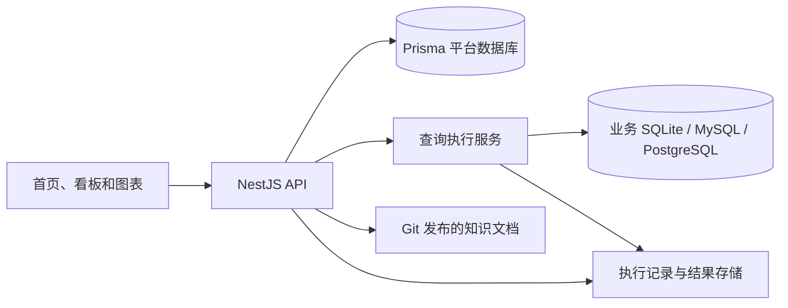

# DataCube 前端真实数据接入方案

> 实施进度与验证记录见 [实施记录](实施记录-前端真实数据接入.md)。

本方案将首页、看板和图表接入真实业务数据，并将图表定义、看板配置和收藏迁移到平台数据库。首个交付切片选择销售经营看板，用一个本地 SQLite 业务库验证从数据源登记到跨浏览器查看的完整流程。首轮通过后，按业务主题依次迁移库存、加工和直播。

## 1. 当前实现

| 页面或模块         | 当前数据来源                                                                                                  | 接入目标                                                                       |
| ------------------ | ------------------------------------------------------------------------------------------------------------- | ------------------------------------------------------------------------------ |
| 身份与会话         | 顶栏身份写死，服务端尚无 Web 登录和会话守卫；种子脚本尚未初始化用户、空间和成员关系                           | 由服务端解析当前会话和空间成员权限                                             |
| 首页               | 初始看板、销售指标和加工异常来自前端常量                                                                      | 收藏从平台数据库读取，业务指标和异常来自已登记查询                             |
| 看板与图表管理     | 看板、收藏、自定义图表和部分结果保存在 `localStorage`；内置卡片使用演示数据                                   | 服务端保存配置和引用，页面读取实际查询结果                                     |
| 图表查询           | `query.sql` 和 `extract.js` 的读取请求由服务端查询 SQLite、MySQL 或 PostgreSQL；JS 转换和周期刷新由浏览器运行 | 复用数据库连接器，把查询定义、执行状态和结果引用交给平台管理                   |
| 数据接入           | 数据源目录由服务端环境变量登记，页面通过访问令牌查看                                                          | 平台数据库保存连接和数据集目录，服务端通过凭据引用建立连接                     |
| 业务知识与 AI 接入 | 知识正文来自仓库 Markdown，部分业务目录和 AI Key 行为仍由前端提供                                             | 知识正文继续由 Git 维护，服务端读取版本并解析目录引用；AI 接入使用真实 API Key |

代码位置见 [应用状态](../apps/web/src/App.tsx)、[首页](../apps/web/src/pages/HomePage.tsx)、[看板图表](../apps/web/src/pages/BoardCharts.tsx) 和 [图表数据服务](../apps/server/src/modules/chart-data/chart-data.service.ts)。

## 2. 目标数据流

- **平台数据库**保存用户、空间、数据源目录、查询定义、图表、看板、收藏及执行状态。沿用当前 Prisma SQLite 和已有迁移。
- **业务数据库**提供订单、退款、库存等明细或业务视图。本地使用独立的 SQLite 业务文件并以只读方式打开。MySQL 和 PostgreSQL 使用相同目录与查询接口，由连接器处理方言和参数绑定。
- **前端**通过现有 API 客户端和 React Query 读取服务端数据。路由参数、弹窗和编辑草稿保留在页面状态中。筛选默认值由看板保存，单次查看的筛选条件可通过链接分享。
- **结果**关联查询版本、有效参数、业务数据时点和执行时间。结果读取按当前空间及数据权限校验。查询为空、结果截断、失败和无权访问分别处理。

平台实体和关联约束见 [数据库设计](数据库设计.md)。

## 3. 第一阶段 销售经营

首轮同时交付销售看板所需的最小服务端读写，包括用户与空间识别、保存一张图表、建立卡片引用和读取看板。第二阶段再补齐面向所有看板和图表的管理操作。

### 身份与会话

这是首轮端到端交付的前置任务。实现邮箱和密码登录，服务端校验密码哈希，签发随机会话令牌。浏览器通过同源 `HttpOnly`、`SameSite=Lax` Cookie 携带令牌，HTTPS 部署启用 `Secure`。平台数据库只保存令牌摘要、用户、到期时间和撤销状态。默认闲置 8 小时失效，最长有效期 7 天。续期时轮换令牌，登出或成员停用后撤销相应会话。

首轮提供登录、读取会话、续期和登出接口。只有一个可用空间时默认进入该空间，有多个时由用户选择。每次访问业务路由都校验会话、目标空间成员资格和资源权限，写请求校验请求来源。开发种子幂等初始化一个本地空间及管理员、普通成员两个账号，初始密码从环境变量输入。两个账号分别验证跨会话读取、收藏隔离和权限拒绝。

### SQLite 数据集与销售口径

在 `DataConnection.kind` 增加 `sqlite`，本地业务文件的绝对路径放在 `settings.path`，仅供服务端读取。SQLite 文件只读打开，目录响应省略实际路径。需要凭据的 MySQL 和 PostgreSQL 连接通过 `secretRef` 取密钥。

以“按日查看净销售额”为首个真实查询。业务侧提供订单和成功退款表，或提供带等价字段的只读视图。登记时校验如下数据集契约。

| 契约字段          | 首轮约定                                                                                                     |
| ----------------- | ------------------------------------------------------------------------------------------------------------ |
| `timeZone`        | 统计时区使用 `Asia/Shanghai`。按此时区确定半开日期区间，再转换为物理字段的查询边界                           |
| `timeFieldFormat` | 为 `timeFieldKey` 及参与归属的退款时间字段明确物理编码，例如北京时间 `YYYY-MM-DD` 或 UTC ISO 8601 时间戳     |
| `amountUnit`      | 在 `DatasetField.unit` 指定每个金额字段的单位，例如人民币元或分，汇总前统一                                  |
| `snapshotTime`    | 契约声明水位来源，例如已登记视图的更新时间列。执行时解析为实际数据时点并写入结果元数据，同时单独记录执行时间 |

销售查询核对订单标识、支付时间、支付金额、渠道、测试订单标记、退款金额、退款状态及成功时间。无法解析水位的数据源显示数据时点未知，首轮净销售额对数前须确认退款截至时点。

按北京时间的原订单支付日期归属销售和退款。退款先按订单汇总，再关联订单。截至数据时点成功的退款扣回原订单支付期。用真实业务库核对单笔订单、多笔退款、跨期退款和无数据的日期，再启用趋势图。口径以仓库已发布版本为准。 [销售经营 v1](knowledge/sales/v1.md)

1. 用 `DataConnection`、`Dataset` 和 `DatasetField` 登记销售数据集，凭据和本地文件路径由服务端配置。现有环境变量目录作为过渡输入，按空间、连接和数据集标识幂等导入。
2. 使用经核对的只读视图及保存查询执行销售趋势。日期范围和渠道通过参数传递，服务端校验查询实际读取的对象和字段。首个切片采用单连接查询。
3. 在图表管理创建趋势图并挂入销售看板。图表保存查询引用、展示配置和口径版本。首页销售入口复用该看板。
4. 由两个浏览器会话验证同一已授权看板可读取。将页面数值与业务库基准 SQL 对数，再验证日期、渠道、空结果和查询失败。

启动这一阶段需要确认业务 SQLite 文件路径、订单和退款的实际表或视图、字段映射，以及可用于对数的日期与渠道。测试库可用于验证接口，业务验收使用真实业务库。

## 4. 第二阶段 图表与看板持久化

Web 会话切换时同步移除共享令牌路径。上线前将图表数据路由迁到会话守卫，清除 `CHART_DATA_TOKEN` 配置、数据接入页令牌表单和 `sessionStorage` 的 `datacube.chart-data-token`，并移除旧 Bearer 校验与请求头注入。迁移验收覆盖旧令牌失效、当前用户可读和越权拒绝。

### API 与状态

下表定义首轮和后续共用的接口。业务错误统一返回 `code` 与可展示的 `message`，未登录返回 `401`，跨空间或不可见资源返回 `404`。请求有效但对可见对象缺少操作权限时返回 `403`。

| 能力                 | 拟定 API                                                                                | 响应与错误语义                                                                                                                                     |
| -------------------- | --------------------------------------------------------------------------------------- | -------------------------------------------------------------------------------------------------------------------------------------------------- |
| 数据源和字段         | `GET /api/datasets`、`GET /api/datasets/:id`                                            | 返回当前会话有权读取的目录和字段                                                                                                                   |
| 图表创建、读取和归档 | `GET/POST /api/charts`、`GET/PATCH /api/charts/:id`                                     | 创建返回图表 ID 和查询版本 ID，归档后现有卡片显示图表已归档                                                                                        |
| 看板列表和详情       | `GET/POST /api/dashboards`、`GET/PATCH /api/dashboards/:id`                             | 返回看板版本，写入冲突返回 `409 DASHBOARD_VERSION_CONFLICT` 和当前版本                                                                             |
| 卡片增删改           | `POST /api/dashboards/:id/cards`、`PATCH/DELETE /api/dashboards/:id/cards/:cardId`      | 新增引用、修改布局与筛选映射、移除卡片均返回新的看板版本                                                                                           |
| 排序和批量布局       | `PATCH /api/dashboards/:id/card-layout`                                                 | 按提交的卡片顺序保存，并在一个事务内更新布局。冲突返回与看板写入相同的 `409`                                                                       |
| 复制和收藏           | `POST /api/dashboards/:id/copies`、`PUT/DELETE /api/dashboards/:id/favorite`            | 复制返回新看板 ID，收藏按用户记录并支持幂等重试                                                                                                    |
| 查询执行             | `POST /api/charts/:id/executions`、`GET /api/query-executions/:id`                      | 提交返回 `202` 和执行 ID。首版轮询直到终态。超时返回 `status: timed_out` 与 `errorCode: QUERY_TIMEOUT`，查询失败返回 `status: failed` 与脱敏错误码 |
| 结果读取与下载       | `GET /api/query-executions/:id/result`、`GET /api/query-executions/:id/result/download` | 分别返回 JSON 和 CSV。成功零行返回空数组；截断以 `truncated` 标记；有权访问但结果已过期时返回 `410 RESULT_EXPIRED`                                 |

所有看板与卡片写入提交 `expectedVersion`，服务端在同一事务内校验版本、空间内引用和看板状态，写入成功后递增版本。卡片顺序使用独立的整数位置，批量布局请求提交完整有序卡片 ID 和位置尺寸，缺失、重复或跨看板 ID 返回参数错误。复制看板时复制布局和筛选配置，沿用图表引用。

### 查询版本与多源绑定

沿用 Prisma 上已有的不可变行约定。每条 `QueryDefinition.id` 就是一个查询版本 ID。服务层只允许插入新查询定义，修改查询时创建新行，再更新 `Chart.queryId`。`QueryExecution.queryId` 在创建执行时取当时的查询版本，后续保持固定，因此历史执行可沿外键还原具体定义。保留被图表或历史执行引用的版本。API 明确以 `queryVersionId` 表达该 ID。

首轮保留现有单 `datasetId`。保存多源 JS 图表前新增 `QueryDatasetBinding(spaceId, queryId, alias, datasetId)`，以查询版本和别名唯一定位绑定，用组合外键限制空间内引用。查询版本的 `spec` 保存脚本和参数契约，字段投影与筛选能力随绑定校验。每次执行及结果读取重新检查所有实际访问的数据集和字段。执行的 `provenance` 按别名记录数据集、连接、字段范围、实际日期区间和数据时点。跨连接的数据由独立绑定读取后交给转换阶段，`DatasetJoin` 继续描述同一连接内的关联。

### 结果存储与访问

首轮新增平台 SQLite 结果表 `QueryResult`，以 `spaceId` 和 `executionId` 关联执行记录，保存列定义、JSON 行数据、大小和创建时间。`resultRef` 保存结果 ID，`resultExpiresAt` 保存历史结果到期时间。为图表触发的执行写入 `QueryExecution.chartId`，通过空间内外键关联图表。初始上限为每次结果 10,000 行、序列化后 10 MiB。首轮销售查询超限返回 `RESULT_TOO_LARGE`，避免用部分数据生成趋势。

执行成功时在事务内保存结果和执行状态，并更新 `ChartLatestResult`。该表按空间、图表、查询版本、规范化参数摘要和权限范围摘要唯一定位，指向最近成功的执行 ID。刷新失败保留该范围内的最近成功结果。同范围内较早启动的执行晚完成时，其结果可进入历史，但更新指针需通过执行顺序校验。查询版本被替换或图表归档时清除旧指针。未被指向的历史结果默认保留 7 天，原先被指向的结果从解除引用时起计。清理任务每日分批删除已过期内容，保留执行记录及过期时间。

读取与下载按当前会话依次校验空间成员、关联图表或看板的可见性、执行归属，以及记录中的全部数据集和字段权限。下载和结果读取均写入 `AuditEvent`，记录操作者、执行 ID 和结果状态。审计仅保留脱敏元数据。

## 5. 第三阶段 首页与业务卡片切换

| 页面内容               | 接入方式                                                                           |
| ---------------------- | ---------------------------------------------------------------------------------- |
| 收藏和团队看板         | 通过同一套看板 API 读取当前用户可见的资产                                          |
| 首页销售指标和趋势     | 复用经对数的保存查询，返回统计周期、对比周期和数据时点                             |
| 首页加工异常与加工卡片 | 查询加工批次和入库核对结果，沿用已发布的损耗口径和复核规则                         |
| 库存和直播卡片         | 分别接入库存快照和直播归因查询，按各自数据源显示数据时点                           |
| 顶栏身份、空间和状态   | 从当前会话读取身份与空间，健康检查展示平台服务状态，业务数据连接状态由目录接口提供 |

按销售、库存、加工、直播顺序切换。每个主题完成数字、范围和权限验收后，再移除对应的演示数据引用。地图底图等展示资源继续由前端提供。无连接配置时提示未配置，已配置且查询返回零行时显示空态。

## 6. 第四阶段 刷新、业务知识与 AI 接入

- **刷新。** 将周期调度迁到后端。手动和定时刷新共用执行服务。同空间、图表、查询版本、规范化参数和权限范围的在途执行使用同一个执行 ID。新结果校验成功后再切换最近成功结果，刷新失败保留上一版并显示失败时间。需要周期运行的 JS 转换在隔离执行环境中运行，保留超时、行数及输出体积限制。
- **业务知识。** 由服务端读取已发布的 Markdown 版本，解析数据集、字段和指标引用。图表保存主题和明确版本，发布新版本后历史图表仍可跳转到原版本。 [业务知识库方案](业务知识库方案.md)
- **AI 接入。** 用 `ApiKey` 和 `ApiKeyScope` 替换演示 Key。创建时展示一次密钥，撤销后终止后续访问。Web、API 和 MCP 共用数据权限与查询执行层。

## 7. 浏览器数据迁移与切换

1. 提供一次性导入入口，读取现有的 `datacube.dashboards.v1`。旧版本会把默认演示看板写入同一份存储。导入器用 `demo.ts` 中的 `sales`、`inventory`、`processing`、`channel` 四个内置看板 ID 及默认内容比对，自动跳过与原始默认内容一致的记录。发现内置看板被改名、调整卡片或修改收藏时，列出改动并由用户选择导入。复制生成新 ID 的看板按用户资产处理，内置卡片逐一映射到已登记的真实图表，无法映射的项列为待处理。
2. 在当前空间内为旧图表和看板生成服务端 ID，并维护旧 ID 到新 ID 的映射。先保存图表，再建立看板、卡片和收藏引用。同一份导入重试时复用映射，避免重复创建。保存历史结果前重新查询真实数据。
3. 核对导入结果中的看板、卡片及图表引用。切换后由 API 负责业务配置读写。浏览器原始导出按迁移备份处理，待用户核对后清理。
4. 按主题部署。切换失败时暂停该主题的入口切换，保留已写入服务端的资产和导入记录，修复后继续验证。

## 8. 验收清单

- 首轮按会话与种子、单源销售查询及结果落库、图表与卡片写入、两会话验收的顺序交付。历史下载、完整资产管理和浏览器导入可随后交付，正式切换前完成共享令牌下线。
- 对真实业务库执行独立 SQL，核对趋势、合计、退款归属和日期窗口。
- 创建图表并加入看板。使用另一个已授权的浏览器会话确认图表、筛选和看板引用可读取。
- 验证收藏按用户隔离、无权限的用户无法读取图表结果、看板版本冲突能被识别。
- 重试同一份旧数据导入，图表与看板数量保持一致。含无效数据源或断裂引用时，页面列出需处理的项。
- 修改业务记录并验证刷新后的新数据。验证空结果、数据源断开、超时和上一次成功结果均能正确显示。
- 验证历史结果到期后返回 `RESULT_EXPIRED`，权限撤销后查看与下载均被拒绝，查看与下载记录可审计。
- 后台调度上线后，关闭所有页面也能执行下一次计划刷新。执行记录可追溯数据源、查询版本、参数和结果时间。
