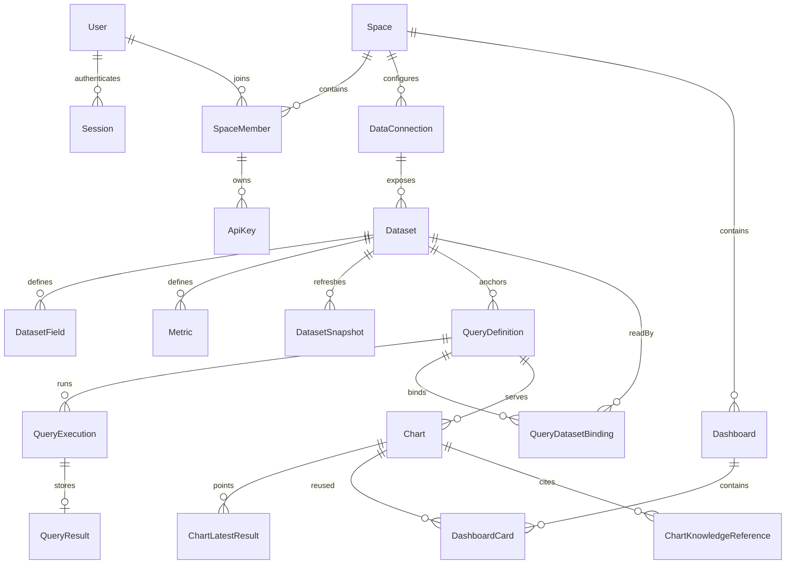

# DataCube 数据库设计

平台元数据沿用 Prisma 5 和 SQLite。MySQL、PostgreSQL 和业务 API 作为外部数据源接入。业务明细由源系统或快照存储提供，SQLite 记录目录、权限、查询和结果引用。表结构以 [Prisma schema](../apps/server/prisma/schema.prisma) 为准。

## 实体关系

| 用途           | 表及约束                                                                                                                                                                               |
| -------------- | -------------------------------------------------------------------------------------------------------------------------------------------------------------------------------------- |
| 会话           | `Session` 只保存令牌摘要、活跃空间、闲置与最长到期时间及撤销时间。会话按用户索引，过期记录由守卫撤销并由清理任务删除。                                                                 |
| 成员与授权     | `SpaceMember` 以空间和用户唯一定位。数据集授权通过 `DatasetGrant`，字段以 `FieldGrant` 白名单授权。移除数据集授权同步清除字段授权。                                                    |
| 数据接入与语义 | `DataConnection` 保存连接类型、非秘密配置和凭据引用。数据集标识在连接内唯一，字段与指标标识在数据集内唯一。`DatasetJoin` 的两端均受同一连接的组合外键约束。                            |
| 快照           | `DatasetSnapshot` 记录每次全量刷新及其结果引用。`ActiveDatasetSnapshot` 为每个数据集指向至多一个本数据集快照。                                                                         |
| 口径           | `KnowledgeGrant` 授权到主题。`ChartKnowledgeReference` 绑定主题及明确版本，正文与版本继续由 [knowledge](knowledge/) 目录提供。                                                         |
| 看板与共享     | `Dashboard` 保存草稿、发布、归档和编辑版本。`DashboardCard` 保存独立位置、布局和筛选映射，可引用共享图表。`DashboardGrant` 和 `DashboardFavorite` 分别维护定向共享与个人收藏。         |
| 查询结果       | `QueryResult` 按空间和执行唯一保存列、行、大小与到期时间。`ChartLatestResult` 按图表、查询版本、参数摘要和权限范围指向最近成功的执行；查询版本替换或归档时清除。                       |
| 外部访问与追溯 | `ApiKey` 保存不可逆摘要和展示前缀，`ApiKeyScope` 保存能力授权。`QueryExecution` 保存任务状态和来源，`AuditEvent` 保存工具调用与内容操作。`IdempotentMutation` 保存重复请求的去重结果。 |

## 服务端写入与读取约定

- 用组合外键限制空间内关联。成员、查询定义、图表和 API Key 被历史记录引用时，以停用、归档或撤销管理生命周期。删除看板卡片仅移除该实例。
- 先检查空间成员有效性，再校验内容权限以及全部实际读取的数据集和字段。API Key 的能力取当前成员权限和 Key 授权的交集。看板共享、历史结果和快照读取沿用同一套数据权限检查。现有 `User.role` 保留为平台角色，空间角色由 `SpaceMember.role` 决定。
- 按当前 Prisma 版本将连接设置、接口契约、图表配置等复杂结构存成 JSON 文本。服务层按模型注释与类型校验结构和状态值，也负责解析数据集的时间字段、指标和关联字段。数据库连接密码和 API Token 由后端通过 `secretRef` 读取。调用记录只保留脱敏元数据。
- 单条查询定义以一个数据集为入口，只允许使用同连接、已授权的关联。执行前固化实际查询和口径来源，记录数据时点、实际时间范围与筛选。成功且行数为零表示空结果，`truncated` 单独表示截断。结果引用按有效期清理。
- 快照刷新先写入数据并验证完整性，再在同一事务中标记成功并切换当前快照。按刷新开始顺序做条件更新，防止较早启动的刷新晚完成时覆盖新版本。失败保留最后一次成功的快照。
- 看板和卡片的修改在同一事务内按空间、看板 ID、预期版本及未归档条件更新，并递增版本。未匹配返回冲突或相应资源状态。复制看板时复制卡片布局与筛选并继续引用相同图表。
- 将内容创建与幂等记录放在同一事务。幂等键按空间、成员和操作隔离。重试先重新验证请求权限，再比对请求摘要，匹配时返回同一资源，不一致时返回冲突。图表或看板的写入来源通过 `origin` 记录。

现阶段交付数据库模型和迁移。上述授权、任务状态转换、配置校验及存储读写由后续服务实现。行级权限和服务账号 Key 保留为产品待确认项。

## 迁移

开发环境执行 `pnpm prisma:migrate`。已有数据库保留原用户记录，部署沿用容器启动时的 `prisma migrate deploy`。
